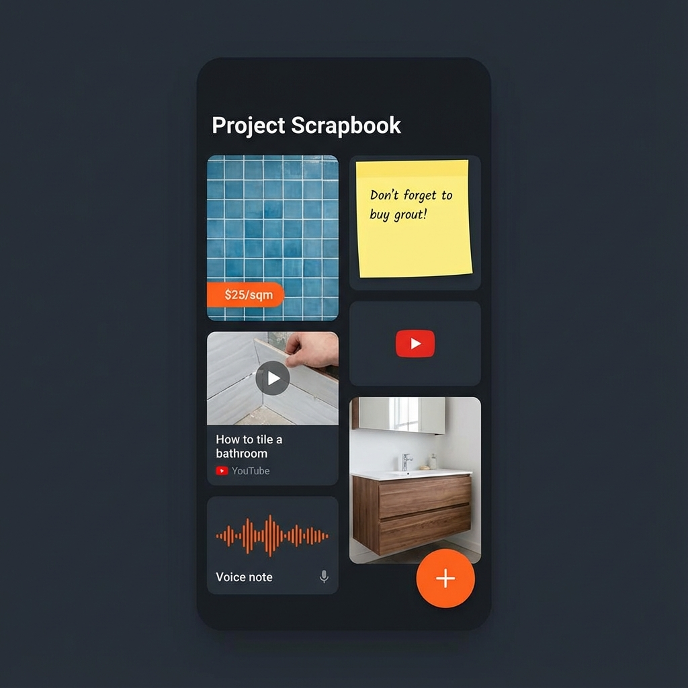

# Project Scrapbook: Design Concept

## Core Philosophy
**"Capture First, Organize Later."**
The current app requires structure (Name -> Date -> Status). The Scrapbook allows chaos. It's a digital bucket for ideas, measurements, and inspiration.

## UI/UX Concept: The "Canvas"
Instead of a list of fields, the main view is a **Masonry Grid** (like Pinterest) or a **Freeform Canvas** (like Miro, but simpler).

### Key UI Elements

1.  **The "Quick Add" FAB (Floating Action Button)**
    *   Located bottom-right, always visible.
    *   Expands to 4 options:
        *   📷 **Camera**: Snap a photo (price tag, corner of a room, sketch).
        *   🎤 **Voice**: Record a thought ("Remember to buy 10% extra tiles").
        *   🔗 **Link**: Paste a URL (YouTube video, product page).
        *   📝 **Note**: Quick text jot.

2.  **The Scrapbook Grid**
    *   **Visual Cards**: Every item has a visual representation.
        *   *Photos*: Full width.
        *   *Notes*: Sticky note style (yellow/pastel background).
        *   *Links*: Rich preview card with thumbnail.
        *   *Voice*: Waveform visualization.
    *   **Drag & Drop**: Reorder items. Group them (e.g., "Bathroom Ideas", "Shopping").

3.  **Smart Context (The "Magic")**
    *   When I upload a photo of a paint can, AI tags it "Material: Paint".
    *   When I record a voice note "Wall is 3 meters", AI extracts "Measurement: 3m".

## User Flow Example

1.  **Inspiration Phase**: User sees a nice bathroom on Instagram. -> *Share to Tooltopia*. It appears in the Scrapbook.
2.  **Planning Phase**: User is at the hardware store. Sees a vanity they like. -> *Snap photo*. Adds price "$400".
3.  **Execution Phase**: User is measuring the room. -> *Voice Note*: "Width is 240cm".
4.  **Review**: User opens the Project Scrapbook. It's a collage of the vanity, the inspiration photo, and the measurements. It's a **Mood Board + Data Sheet**.

## Technical Implementation Strategy
*   **Storage**: Supabase Storage for media. `scrapbook_items` table with JSONB for flexible metadata.
*   **UI Library**: `react-grid-layout` or `framer-motion` for the draggable grid.
*   **AI**: Use Gemini/OpenAI Vision to auto-tag images and Whisper for voice-to-text.

## Visual Mockup

*   **Header**: Project Title ("Guest Bath Reno") + Progress Bar.
*   **Body**: A 2-column masonry layout.
    *   *Top Left*: Photo of a tile sample.
    *   *Top Right*: Yellow sticky note "Budget: $2000".
    *   *Middle Left*: YouTube embed "How to grout".
    *   *Middle Right*: Voice note "Measurements".
*   **Bottom**: Large "+" Button.
